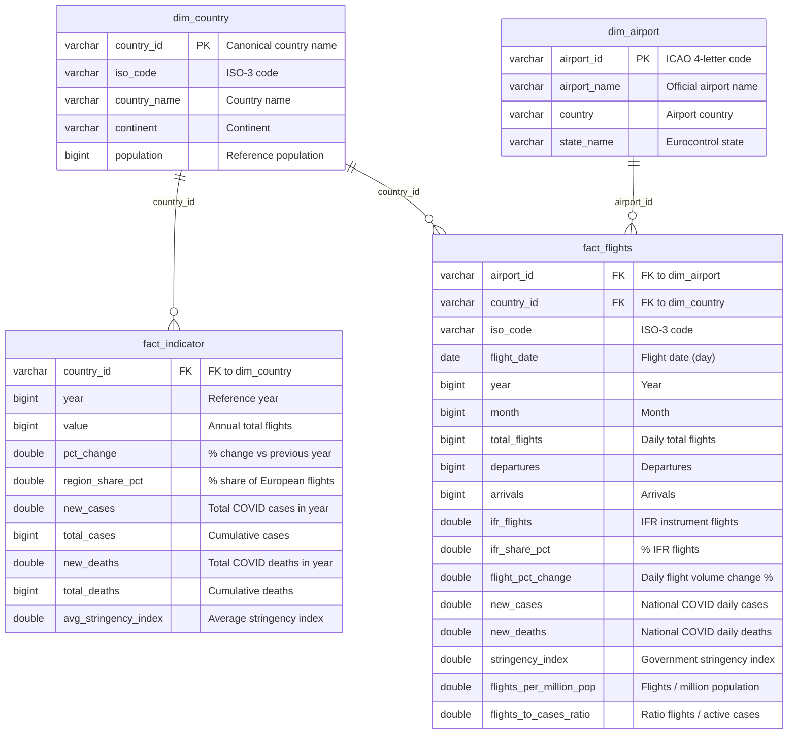

# Trabalho de Engenharia de Dados (ECOX14) da UNIFEI em 2026.2

## Fontes de dados

| Fonte | Formato | Acesso | Extraído em | Link |
| --- | --- | --- | --- | --- |
| Our World in Data - COVID-19 | CSV | token | 20/08/2026 | www.kaggle.com/datasets/caesarmario/our-world-in-data-covid19-dataset |
| Air Traffic in Europe from 2016 to 2024 | CSV | token | 20/08/2026 | www.kaggle.com/datasets/samithsachidanandan/air-traffic-in-europe-from-2016-to-2024 |

## Arquitetura e Decisões de Projeto

O projeto adota os princípios de Engenharia de Dados na Prática apresentados nas aulas da disciplina:
1. **Centralização de Configurações (`src/config.py`)**: Caminhos calculados dinamicamente a partir de `ROOT_DIR = Path(__file__).resolve().parent.parent`. Elimina erros de dependência do diretório corrente e centraliza parâmetros e pastas.
2. **Substituição de `print` por `logging`**: Rastreabilidade com carimbo de data, hora, nível (`INFO`, `WARNING`, `ERROR`) e gravação simultânea no terminal e em `pipeline.log` (ignorado no versionamento).
3. **Orquestração e Retomada (`src/pipeline.py`)**: O pipeline é estruturado em etapas sequenciais com declaração explícita de etapas futuras (`None`), suportando execução total ou retomada a partir de uma etapa intermediária (`python src/pipeline.py enrich`).
4. **Camada Prata e Enriquecimento**: O cruzamento entre as fontes tratadas é uma etapa de **Enriquecimento** que ainda pertence à camada **Prata** (`data/silver/enriched/`).
5. **Camada Ouro e Carga em Banco Analítico (`project.duckdb`)**: Transição de diretórios para esquemas relacionais no DuckDB (`silver` e `gold`). O DuckDB é um SGBD analítico (OLAP) embutido, colunar, sem servidor, com suporte nativo a Parquet. Implementa modelagem dimensional (esquema estrela) gerenciada declarativamente pelo dbt, com testes de grão e integridade referencial antes de disponibilizar visões consolidadas.
6. **Entrega do Dado e Visualização (Dashboard Streamlit)**: O dado chega ao usuário final através de um painel interativo desacoplado. O painel é puramente consumidor (`read_only=True`) e opera sobre a camada Ouro sem interferir no pipeline de dados.

---

## Como Instalar e Rodar o Projeto

No PowerShell, a partir da pasta raiz do projeto e com o ambiente virtual ativado:

### 1. Instalação de Dependências
```powershell
# Ativar o ambiente virtual no Windows
.\venv\Scripts\Activate.ps1

# Instalar pacotes necessários (DuckDB, dbt, Streamlit, Pandas, etc.)
pip install -r requirements.txt
```

### 2. Executar o Pipeline Completo (Ponta a Ponta)
```powershell
python src/pipeline.py
```
*(Executa sequencialmente: `ingest` $\rightarrow$ `transform` $\rightarrow$ `enrich` $\rightarrow$ `load` $\rightarrow$ `modeling`).*

### 3. Executar ou Retomar por Etapas Específicas
| Comando | O que executa |
| :--- | :--- |
| `python src/pipeline.py ingest` | Baixa dados brutos do Kaggle para `data/bronze/` |
| `python src/pipeline.py transform` | Limpa e padroniza dados brutos para Parquet em `data/silver/` |
| `python src/pipeline.py enrich` | Cruza voos diários com métricas de COVID-19 em `data/silver/enriched/` |
| `python src/pipeline.py load` | Carrega os Parquets limpos nas tabelas relacionais `silver.*` do DuckDB |
| `python src/pipeline.py modeling` | Executa `dbt run` (materializa tabelas/views na `gold`) e `dbt test` (16 testes) |

### 4. Executar o Dashboard Interativo (Streamlit)
```powershell
streamlit run dashboard/app.py
```
*(Inicia o painel analítico no navegador em `http://localhost:8501`. Conecta ao banco em modo somente leitura `read_only=True` sem travar o arquivo).*

### 5. Documentação do Modelo com dbt (`dbt docs`)
```powershell
# Gerar catálogo e documentação a partir do código e schema.yml
$env:USERPROFILE = (Get-Location).Path; Set-Location ecox14; ..\venv\Scripts\dbt.exe docs generate

# Visualizar a documentação interativa e o DAG de modelos no navegador
$env:USERPROFILE = (Get-Location).Path; Set-Location ecox14; ..\venv\Scripts\dbt.exe docs serve
```

### 6. Executar a Suíte Completa de Testes Automatizados
```powershell
python -m unittest discover tests
```
*(Executa 29 testes unitários cobrindo transformação, mapeamento, enriquecimento, carga DuckDB e consultas parametrizadas do dashboard).*


---

## Decisões de Transformação (Camada Prata)

### COVID-19 (`data/silver/covid19/covid19.parquet`)
- **Remoção de espaços**: Padroniza nomes de colunas e textos.
- **Harmonização de escopo geográfico**: Inclui países europeus e parceiros Eurocontrol classificados pelo OWID fora do continente (Turquia, Armênia, Geórgia, Israel e Marrocos), totalizando **82.719 registros**.
- **Chave de identidade temporal**: `iso_code + date`.
- **Atributos de saúde e políticas públicas**: Preserva `stringency_index` (índice de rigor governamental de 0 a 100), `new_cases_per_million`, `total_cases_per_million` e variação percentual segura de novos casos.
- **Linhagem**: Registrada em `data/silver/covid19/provenance.jsonl`.

### Air Traffic Europe (`data/silver/air-traffic-EU/air-traffic-EU.parquet`)
- **Filtro de período**: Anos de 2019 a 2024 (período pré-pandêmico de referência e recuperação), com **677.190 registros**.
- **Chave de identidade temporal**: `YEAR + FLT_DATE + APT_ICAO`.
- **Métricas operacionais**: Cálculo de `TOTAL_FLIGHTS`, `TOTAL_IFR_FLIGHTS`, `IFR_SHARE` e variação percentual diária por aeroporto tratando divisões por zero.
- **Linhagem**: Registrada em `data/silver/air-traffic-EU/provenance.jsonl`.

---

## Junção e Enriquecimento (`data/silver/enriched/flights_covid_enriched.parquet`)

A série de voos foi unida ao contexto de COVID-19 por `(country_name, FLT_DATE)` $\leftrightarrow$ `(country_name, date)` utilizando `how="left"` e `validate="many_to_one"`.

- **Linhas na série (voos):** 677.190
- **Linhas no resultado:** 677.190 (o grão foi rigorosamente preservado, sem duplicação de linhas)
- **Sem par no cadastro de COVID:** 251.947

### Quem não casou

Uma junção `left` preserva todos os registros da série, permitindo diagnosticar exatamente quem não casou em vez de apagar os dados silenciosamente como faria um `inner join`:

- **113.975 registros são de 2019:** Período pré-pandêmico. A coleta de dados do OWID só se inicia em 03/01/2020. Manter 2019 sem par é fundamental para servir como linha de base (*baseline*) para o cálculo de índices de recuperação.
- **114.754 registros são de 2024:** O dataset público do OWID encerrou suas coletas no final de 2023, enquanto a Eurocontrol cobre 2024.
- **22.622 registros são do final de 2023:** Meses de novembro e dezembro após a interrupção das métricas diárias do OWID.
- **596 registros são do início de janeiro de 2020:** Dias anteriores ao primeiro caso notificado em pequenos parceiros Eurocontrol.
- **Durante os anos mais críticos da pandemia (2021 e 2022):** **0 registros sem par** (100% de correspondência entre voos e métricas de COVID).

### Atributos que só existem após a junção

Conforme o método ensinado em aula, foram calculados atributos que só são possíveis com a fusão das duas fontes:

1. `flights_per_million_pop`: Volume diário de voos do aeroporto normalizado pela população nacional do país (`TOTAL_FLIGHTS / (population / 1_000_000)`). Permite comparar a densidade e a dependência do transporte aéreo entre países de portes populacionais discrepantes (como Luxemburgo/Holanda vs. Alemanha).
2. `flights_to_cases_ratio`: Razão entre as operações de voo diárias e os novos casos de COVID no país (`TOTAL_FLIGHTS / (new_cases + 1)`), expressando a resiliência operacional da aviação frente à intensidade do contágio diário.

---

## Modelagem Dimensional e Carga em Banco (Camada Ouro)

Nesta etapa, implementamos a modelagem dimensional e a carga no banco de dados analítico **DuckDB** (`data/gold/project.duckdb`), seguindo os princípios de engenharia da disciplina e os padrões do projeto (nomenclatura em inglês em arquivos, variáveis e esquemas analíticos).

### Por que DuckDB?
1. **Banco Embutido (In-Process)**: Funciona como uma biblioteca em Python (`import duckdb`), gerando um único arquivo no disco (`project.duckdb`). Não requer servidor dedicado, portas de rede, senhas ou configurações de Docker. Apagar o arquivo reinicia o banco do zero de forma reprodutível.
2. **Orientado a Colunas (OLAP)**: Otimizado para consultas analíticas de agregação (`SUM`, `AVG`, `GROUP BY`). Em vez de escanear linhas inteiras na memória, lê apenas as colunas envolvidas no cálculo.
3. **Leitura Nativa de Parquet**: Executa `read_parquet()` sem etapa intermediária de importação ou cópia, preservando os tipos e metadados gerados na Prata.
4. **Camadas viram Esquemas**: A divisão das camadas de engenharia de dados deixa de ser exclusivamente física em pastas no disco e passa a ser lógica dentro do SGBD:
   - `silver`: recebe as tabelas espelhadas diretamente dos arquivos Parquet (`air_traffic_eu`, `covid19`, `flights_covid_enriched`).
   - `gold`: hospeda o modelo dimensional (tabelas de dimensão, tabelas de fatos e visões de consumo analítico).

---

### As Três Perguntas da Modelagem (Decisões de Design)

Antes de escrever qualquer instrução SQL, a modelagem dimensional exige responder a três perguntas fundamentais (Kimball, 2013):

#### 1. Quais tabelas vão existir?
A camada Ouro organiza os dados em duas naturezas complementares:
- **Dimensões (O que descreve - contexto analítico)**:
  - `gold.dim_country`: Contexto demográfico e geográfico dos países europeus e parceiros.
  - `gold.dim_airport`: Cadastro operacional dos aeroportos monitorados pela Eurocontrol.
- **Fatos (O que se mede - eventos e métricas)**:
  - `gold.fact_indicator`: Fato agregada anual por país (`country_id, year`), calculando volume anual de voos (`value`), variação percentual anual (`pct_change`), participação no tráfego europeu (`region_share_pct`) e consolidação de COVID-19.
  - `gold.fact_flights`: Fato operacional detalhada no grão diário de aeroportos (`airport_id, flight_date`), contendo volume de voos, chegadas, partidas, taxa IFR e métricas cruzadas (`flights_per_million_pop`, `flights_to_cases_ratio`).

- **Visões Analíticas (Views)**:
  - `gold.vw_complete_indicator`: Visão analítica anual unindo a fato de indicadores com a dimensão país.
  - `gold.vw_complete_flights`: Visão operacional que recria a tabela achatada sob demanda através de junções instantâneas.

#### 2. Qual é o grão de cada tabela?
O grão define rigorosamente o que representa uma única linha da tabela:

> [!IMPORTANT]
> **Declaração do Grão da Fact Indicator:**
> **"Uma linha de `gold.fact_indicator` é um país em um ano."**
> - **Chave primária natural**: `(country_id, year)`.
> - **O que é duplicata**: O mesmo país no mesmo ano mais de uma vez.
> - **O que pode ser somado**: Voos e óbitos entre países diferentes em um mesmo ano. Somar valores entre anos do mesmo país não possui significado físico para métricas de estoque/cumulativas.
>
> **Declaração do Grão da Fact Flights:**
> **"Uma linha de `gold.fact_flights` é um aeroporto em uma data (dia)."**
> - **Chave primária natural**: `(airport_id, flight_date)`.
> - **O que é duplicata**: O mesmo aeroporto na mesma data duas vezes.
> - **O que pode ser somado**: Voos diários de diferentes aeroportos para obter totais nacionais ou continentais.
>
> **Declaração do Grão das Dimensões:**
> - **`gold.dim_country`**: Uma linha por país (`country_id` único, 60 países).
> - **`gold.dim_airport`**: Uma linha por aeroporto (`airport_id` único, 334 aeroportos).

#### 3. Como elas se ligam? (Esquema Estrela)



---

### Destinos do Arquivo Enriquecido (`flights_covid_enriched.parquet`)
O arquivo gerado na etapa anterior ganha três destinos formais:
1. **Entrada da Tabela Fato**: Os tratamentos de integridade já executados alimentam a construção da fato, e registros fora do escopo pandêmico (como o ano base de 2019 e a recuperação de 2024) são auditados (`251.947` registros sem par COVID).
2. **Consulta Salva (VIEW)**: A tabela achatada não precisa ser duplicada no disco. As visões `gold.vw_complete_indicator` e `gold.vw_complete_flights` realizam os `JOINs` instantaneamente em tempo de execução no DuckDB.
3. **Fonte Única de Verdade**: Correções de cadastro passam a ser feitas em uma única linha da dimensão, propagando-se imediatamente para qualquer visão de consumo.

---

### Conferência de Consistência e Integridade (`validate_model_integrity()`)

A função `validate_model_integrity()` em [`src/load_data.py`](file:///c:/Users/tauch/.vscode/EngDados/src/load_data.py) valida matematicamente:

1. **Confirmação do Grão (Duplicatas = 0)**:
   - Em `gold.fact_indicator`, o agrupamento por `(country_id, year)` deve retornar `0` duplicatas (`HAVING COUNT(*) > 1`).
   - Em `gold.fact_flights`, o agrupamento por `(airport_id, flight_date)` deve retornar `0` duplicatas.
2. **Ausência de Fatos Órfãos (Integridade Referencial = 0)**:
   - Todo registro de `fact_indicator` possui chave correspondente em `dim_country` (`WHERE d.country_id IS NULL -> 0`).
   - Todo registro de `fact_flights` possui chave correspondente em `dim_airport` (`WHERE a.airport_id IS NULL -> 0`) e em `dim_country` (`WHERE d.country_id IS NULL -> 0`).

**Resultado da auditoria automática:**
```text
Validation check - duplicate indicator pairs (country, year) : 0 (expected: 0)
Validation check - orphan indicator records without country   : 0 (expected: 0)
Validation check - duplicate flight pairs (airport, date)    : 0 (expected: 0)
Validation check - orphan flight records without airport     : 0 (expected: 0)
Validation check - orphan flight records without country     : 0 (expected: 0)
```

---

## Transformação Declarativa com dbt (Aula 10)

Na Aula 10, a construção da camada **Ouro** e a validação de regras de negócio evoluem do paradigma **imperativo** (scripts Python executando comandos DDL/DML manuais via `con.execute()`) para o paradigma **declarativo**, utilizando o **dbt (data build tool)** com o adaptador **dbt-duckdb**.

### 1. Por que Transformação Declarativa?
- **Imperativo (Python + SQL string)**: O engenheiro precisa ditar *como* criar cada objeto (`CREATE OR REPLACE TABLE`, ordenação de dependências na mão, commits manuais, tratamento de boilerplate e tratamento de concorrência). Se uma tabela mudar de ordem, o script pode falhar por falta de dependência prévia.
- **Declarativo (dbt)**: O engenheiro declara apenas *o que* os dados devem ser (uma consulta `SELECT` com referências `{{ ref('...') }}` e `{{ source('...') }}`). O dbt:
  1. Constrói automaticamente o **Grafo Acíclico Dirigido (DAG)** de dependências.
  2. Determina a ordem exata de execução paralela ou sequencial dos modelos.
  3. Gerencia materializações (`table`, `view`, `incremental`) via configuração simples.
  4. Executa testes automatizados de qualidade de dados (Data Quality) antes de considerar os modelos válidos para consumo.

---

### 2. Estrutura do Projeto dbt (`ecox14/`)

O projeto dbt reside no diretório [`ecox14/`](file:///c:/Users/tauch/.vscode/EngDados/ecox14/) com a seguinte organização:

```text
ecox14/
├── dbt_project.yml               # Configuração global do projeto dbt
├── profiles.yml                  # Configuração de conexão com data/gold/project.duckdb
├── macros/
│   └── generate_schema_name.sql  # Macro para manter esquema direto 'gold' sem prefixos
├── models/
│   ├── sources.yml               # Declaração das fontes da camada silver
│   ├── dim_country.sql           # Dimensão País (materialized='table')
│   ├── dim_airport.sql           # Dimensão Aeroporto (materialized='table')
│   ├── fact_indicator.sql        # Fato Indicadores Anuais (materialized='table')
│   ├── fact_flights.sql          # Fato Voos Diários por Aeroporto (materialized='table')
│   ├── vw_complete_indicator.sql # Visão Analítica Indicadores (materialized='view')
│   ├── vw_complete_flights.sql   # Visão Analítica Voos (materialized='view')
│   └── schema.yml                # Documentação e testes genéricos de qualidade
└── tests/
    ├── assert_fact_flights_unique_grain.sql    # Teste singular de grão (airport_id, flight_date)
    └── assert_fact_indicator_unique_grain.sql  # Teste singular de grão (country_id, year)
```

---

### 3. Fontes e Modelos Declarados

#### Fontes (`models/sources.yml`)
Declara as tabelas existentes no esquema `silver` carregadas a partir dos Parquets limpos:
- `silver.air_traffic_eu`
- `silver.covid19`
- `silver.flights_covid_enriched`

#### Modelos Dimensionais (Dimensões)
- **`dim_country`**: Modelada a partir de `{{ source('silver', 'covid19') }}`, extraindo os atributos canônicos dos países (`country_id`, `iso_code`, `continent`, `region`, `population`).
- **`dim_airport`**: Modelada a partir de `{{ source('silver', 'air_traffic_eu') }}`, consolidando nomes e estados através da função `ARG_MAX(apt_name, flt_date)`.

#### Modelos de Fatos (Métricas e Eventos)
- **`fact_indicator`**: Agrega métricas anuais de aviação e COVID-19 por país, calculando derivadas via funções de janela SQL (`LAG` para variação percentual anual e particionamento anual para `region_share_pct`).
- **`fact_flights`**: Fato operacional no nível de detalhe diário por aeroporto. Utiliza `QUALIFY ROW_NUMBER() OVER (PARTITION BY apt_icao, flt_date ORDER BY flight_volume_pct_change DESC) = 1` para garantir a unicidade absoluta do grão operacional.

#### Visões Analíticas (Views)
- **`vw_complete_indicator`**: Unifica `fact_indicator` com `dim_country`.
- **`vw_complete_flights`**: Unifica `fact_flights` com `dim_airport` e `dim_country`.

---

### 4. Testes de Qualidade de Dados (dbt Tests)

O dbt implementa dois níveis rigorosos de validação:

#### A. Testes Genéricos de Schema (`schema.yml`)
- **Unicidade de Chave Primária (`unique`)**:
  - `dim_country.country_id`
  - `dim_airport.airport_id`
- **Valores Não-Nulos (`not_null`)**:
  - Chaves primárias e estrangeiras em todas as dimensões e fatos (`country_id`, `airport_id`, `flight_date`, `year`, `iso_code`, `airport_name`).
- **Integridade Referencial (`relationships`)**:
  - `fact_indicator.country_id` $\rightarrow$ `dim_country.country_id`
  - `fact_flights.airport_id` $\rightarrow$ `dim_airport.airport_id`
  - `fact_flights.country_id` $\rightarrow$ `dim_country.country_id`

#### B. Testes Singulares (Custom SQL Tests)
Validam o grão composto em SQL puro, garantindo que nenhuma combinação de chave ocorra mais de uma vez. O teste passa quando a consulta retorna **0 linhas**:
- `assert_fact_indicator_unique_grain.sql`:
  ```sql
  select country_id, year, count(*) as row_count
  from {{ ref('fact_indicator') }}
  group by country_id, year
  having count(*) > 1
  ```
- `assert_fact_flights_unique_grain.sql`:
  ```sql
  select airport_id, flight_date, count(*) as row_count
  from {{ ref('fact_flights') }}
  group by airport_id, flight_date
  having count(*) > 1
  ```

---

### 5. Integração com o Pipeline Principal (`src/pipeline.py`)

A separação de responsabilidades no pipeline segue o padrão moderno de arquitetura de dados:
1. **Etapa `load` (`src/load_data.py`)**: Conecta ao DuckDB, cria os esquemas lógicos `silver` e `gold`, e carrega os arquivos Parquet limpos para as tabelas `silver.*`.
2. **Etapa `modeling` (`run_modeling()`)**: Invoca o dbt de forma automatizada via `subprocess`:
   - Executa `dbt run` (compila o grafo e materializa 4 tabelas e 2 views).
   - Executa `dbt test` (roda todos os 16 testes de integridade, grão e chaves).
   - Em caso de falha em qualquer teste, interrompe a execução com erro explícito.

---

## Testes, Documentação e Entrega do Dado (Aula 11)

A Aula 11 conclui o ciclo de vida da engenharia de dados conectando a infraestrutura técnica à ponta final: **as pessoas que tomam decisões**. Conforme destacado na disciplina:
> *"Um pipeline que ninguém consulta é um pipeline que ninguém sente falta quando quebra. Chegar em alguém não é enfeite: é o que justifica tudo que veio antes."*

A entrega confiável do dado apoia-se em três pilares fundamentais implementados nesta etapa:

```text
+-----------------------------------------------------------------------------------+
|                                 FLUXO COMPLETO                                    |
|                                                                                   |
|  [Fontes Públicas]                                                                |
|  Kaggle / OWID / Eurocontrol                                                      |
|         │                                                                         |
|         ▼                                                                         |
|  [data/bronze/]  ──▶ [data/silver/] ──▶ [data/gold/project.duckdb]                |
|      (Bruto)            (Tratado)         (Esquemas silver e gold)                |
|                                                     │                             |
|                                                     │ (somente leitura)           |
|                                                     ▼                             |
|                                        [dashboard/app.py (Streamlit)]             |
|                                        • Consumidor desacoplado                   |
|                                        • Zero SQL na tela                         |
|                                        • SQL parametrizado em queries.py          |
+-----------------------------------------------------------------------------------+
```

---

### 1. O Dashboard é Consumidor, Não Produtor

A relação entre o painel analítico e o banco de dados analítico obedece a regras estritas de isolamento:
- **A seta aponta apenas em um sentido**: O painel visualiza a camada Ouro, mas não cria nem altera dados. Toda a transformação de engenharia já aconteceu no pipeline e no dbt.
- **Pasta própria (`dashboard/`)**: Fica fora de `src/` porque o dashboard consome o resultado final e não faz parte da esteira produtora do pipeline.
- **Conexão estrita em modo somente leitura (`read_only=True`)**:
  ```python
  con = duckdb.connect(str(DB_PATH), read_only=True)
  ```
  - **Evita travamento do arquivo**: O DuckDB em modo de escrita bloqueia o arquivo físico em disco para processos externos. Com `read_only=True`, o painel pode ficar aberto no navegador enquanto engenheiros continuam rodando o pipeline ou o dbt sem conflitos de lock.
  - **Fail-fast contra mutações acidentais**: Se qualquer consulta tentar executar um `INSERT`, `UPDATE` ou `DROP`, o banco recusa a operação instantaneamente.

---

### 2. Onde o SQL Deve Morar: Desacoplamento Arquitetural

Um erro clássico em aplicações de dados é misturar consultas SQL no meio do código de renderização visual. No projeto, adotamos a separação ensinada em aula:

| Tipo de SQL | O que faz | Onde fica |
| :--- | :--- | :--- |
| **Criação e modelagem** | `dim_country`, `fact_indicator`, etc. | Modelos dbt em [`ecox14/models/`](file:///c:/Users/tauch/.vscode/EngDados/ecox14/models/) (versionado e testado) |
| **Consultas de leitura** | Agrupamentos por região, filtros por ano, rankings | Módulo [`dashboard/queries.py`](file:///c:/Users/tauch/.vscode/EngDados/dashboard/queries.py) |
| **Visualização / Tela** | Gráficos, métricas, sidebar e layout | Interface [`dashboard/app.py`](file:///c:/Users/tauch/.vscode/EngDados/dashboard/app.py) (**Zero SQL**) |

#### Benefícios dessa separação:
1. **Reaproveitamento**: Se um usuário pedir os mesmos números por relatório, e-mail ou API REST, as funções de [`dashboard/queries.py`](file:///c:/Users/tauch/.vscode/EngDados/dashboard/queries.py) já existem prontas e testadas, sem depender do Streamlit.
2. **Defesa contra Injeção de SQL**: Valores vindos dos componentes da tela nunca são concatenados em f-strings (`f"... WHERE regiao = '{regiao}'"`). Todas as consultas utilizam parâmetros posicionais (`?`):
   ```python
   # Seguro contra SQL Injection
   con.execute(sql, [region, year])
   ```

---

### 3. Recursos do Painel Interativo ([`dashboard/app.py`](file:///c:/Users/tauch/.vscode/EngDados/dashboard/app.py))

O painel analítico oferece exploração dinâmica com os seguintes componentes:
- **Barra Lateral Interativa (`st.sidebar`)**: Filtros dinâmicos de ano (2019 a 2024), região e país de foco alimentados diretamente por consultas do DuckDB.
- **KPIs de Destaque (`st.metric`)**: Total consolidado de voos no recorte, novos casos de COVID-19, índice médio de rigidez governamental (*Stringency Index*) e contagem de nações.
- **Sobreposição Temporal Comparativa (Impact Analysis)**:
  - Sobreposição gráfica de **Voos Totais**, **Índice de Rigor Governamental** e **Novos Casos de COVID-19** ao longo do tempo.
  - **Toggles On/Off independentes** (`st.toggle`) para ativar ou desativar qualquer um dos três indicadores.
  - **Escala Normalizada (0 a 100%)**: Como voos (milhares), casos de COVID (milhões) e rigidez governamental (0 a 100) possuem ordens de grandeza distintas, o modo normalizado coloca as três séries na mesma escala percentual relativa ao pico de cada uma, permitindo visualizar com clareza o momento exato em que o aperto das restrições derrubou o tráfego aéreo.
  - Suporte a granularidade **Mensal** (captura picos de ondas e *lockdowns*) ou **Anual** (visão macro).
- **Distribuição Regional de Tráfego (`st.bar_chart`)**: Ranking dos 10 maiores países em volume operacional de voos.
- **Tabela Detalhada (`st.dataframe`)**: Exibição dos indicadores anuais, variações percentuais em relação ao ano anterior (*YoY*) e participação regional (*share %*).
- **Trajetória Histórica (2019–2024) (`st.line_chart`)**: Gráfico de linha demonstrando o impacto da pandemia e a velocidade de recuperação operacional do país selecionado.
- **Maiores Aeroportos (`st.dataframe`)**: Detalhamento dos aeroportos com maior movimentação e respectiva proporção de voos por instrumentos (IFR).

---

### 4. Documentação Viva com dbt (`dbt docs`)

Em vez de manter dicionários de dados em planilhas que se desatualizam quando o esquema muda:
- As descrições de modelos e colunas foram registradas no arquivo [`ecox14/models/schema.yml`](file:///c:/Users/tauch/.vscode/EngDados/ecox14/models/schema.yml), ao lado dos próprios testes de integridade.
- O comando `dbt docs generate` compila os metadados do banco e constrói o catálogo analítico (`catalog.json`).
- O comando `dbt docs serve` expõe uma interface gráfica navegável contendo a linhagem completa (DAG), tipos de dados, documentação de colunas e regras de validação.

---

### 5. Governança, Linhagem e LGPD

No momento em que o dado é entregue a uma pessoa, ele passa a embasar decisões. O projeto atende às três perguntas centrais da governança de dados:

1. **De onde veio este número?**
   - **Rastreabilidade e Proveniência**: Cada camada registra metadados de extração e tratamento em arquivos `provenance.jsonl`.
   - **Transparência na UI**: O rodapé do dashboard (`st.caption`) declara expressamente as fontes de dados primárias (*Eurocontrol* e *Our World in Data*) e a contagem de registros exibidos.
2. **Quem pode vê-lo e como é protegido?**
   - **Adequação à LGPD (Lei Geral de Proteção de Dados)**: O projeto utiliza exclusivamente fontes públicas de estatísticas agregadas (nível aeroporto e nível país). Nenhum dado pessoal identificável (PII) é coletado ou armazenado por decisão deliberada de arquitetura.
3. **O que acontece se um número estiver errado?**
   - **Reprodutibilidade**: A linhagem ponta a ponta (do CSV bruto na Bronze até as tabelas Ouro no DuckDB) permite reconstruir e auditar exatamente como cada métrica derivada (`pct_change`, `region_share_pct`, `flights_to_cases_ratio`) foi calculada.
   - **Barreira de Testes**: 16 testes automatizados no dbt e 29 testes unitários em Python bloqueiam dados inconsistentes antes de chegarem à visualização.


